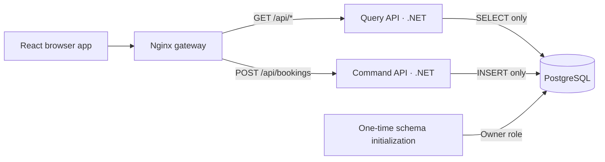

# Branch appointments

A responsive React + TypeScript application for booking a branch visit, backed by two independently deployable .NET 10 APIs and PostgreSQL 18. The interface draws on Capitec's red, navy and white visual language without copying its website. This is a sample application, unaffiliated with Capitec. Branch addresses, opening hours and services are illustrative seed data, not a live bank directory.

Customers choose a branch and service, select an available half-hour slot, enter their details, review the booking and receive a persisted simulated email confirmation. No email or SMS is actually sent. Availability comes from PostgreSQL; there is no pretend in-memory runtime backend.

## Run with Docker

Install Docker Engine/Desktop with Docker Compose v2 and Python 3.10+. From the project directory:

```sh
python scripts/configure-env.py
docker compose up --build -d
```

Open [http://localhost:8080](http://localhost:8080). The environment helper generates four independent secrets in an ignored `.env` file and refuses to overwrite existing configuration. Alternatively, copy `.env.example` to `.env` and fill every required value with separate random strings of at least 32 alphanumeric characters. Semicolons must not appear in database passwords because Compose embeds them into connection strings.

Only the web entry point is published, bound to localhost. PostgreSQL and the APIs remain on internal Docker networks. Compose initializes the schema and restricted roles once, waits for PostgreSQL readiness and restarts failed containers. Stored bookings survive `docker compose down` and subsequent restarts.

```sh
docker compose logs -f command-api query-api
docker compose down
```

The root `Dockerfile` builds either .NET service; the frontend has its own multistage Dockerfile:

```sh
docker build --build-arg SERVICE=Booking.CommandApi -t booking-command .
docker build --build-arg SERVICE=Booking.QueryApi -t booking-query .
docker build -t booking-web frontend
```

The API containers use the .NET non-root user; the Nginx frontend runs as UID 101. Application filesystems are read-only with temporary writable mounts. Request bodies, timeouts and request rates are bounded. The gateway applies a restrictive content security policy and does not cache booking data.

### Rancher Desktop on Windows

Rancher Desktop can provide the Docker engine and CLI for this stack. Its container engine must be **Moby (dockerd)** and show a running state before starting Compose. The supplied gateway uses Docker's embedded DNS, so the configuration expects the Docker API rather than containerd/nerdctl.

If Rancher Desktop's bundled tools are installed but absent from `PATH`, invoke them explicitly in PowerShell:

```powershell
$rancherTools = 'C:\Program Files\Rancher Desktop\resources\resources\win32'
$env:PATH = "$rancherTools\bin;$rancherTools\docker-cli-plugins;$env:PATH"
& "$rancherTools\bin\docker.exe" version
& "$rancherTools\docker-cli-plugins\docker-compose.exe" up --build -d
```

Generate `.env` with `python scripts/configure-env.py` first if it does not already exist. `docker version` must report both client and server; a bundled CLI alone does not establish that the engine is running. These commands use the active Docker endpoint/context, which should point to Rancher Desktop.

On the validation host, Rancher Desktop's Windows Docker proxy lost its Hyper-V socket connection after the images built, while the Linux Docker daemon remained healthy. Running Compose directly inside the existing Rancher WSL distribution started the full stack and passed the smoke test; no application or Compose configuration change was required:

```powershell
$linuxCompose = '/mnt/c/Program Files/Rancher Desktop/resources/resources/linux/docker-cli-plugins/docker-compose'
function Invoke-RancherCompose {
    & wsl.exe --distribution rancher-desktop --cd '/mnt/e/dev/branch-booking' --exec $linuxCompose @args
}
Invoke-RancherCompose up --detach --no-build
Invoke-RancherCompose ps
```

Adapt the WSL project path if the checkout is elsewhere. Stop the stack with `Invoke-RancherCompose down`; this preserves the database volume. The corresponding rebuild-and-start form is `Invoke-RancherCompose up --build --detach`, but rebuilding through this WSL fallback has not been verified on this host: the verified image builds used the bundled Windows Compose CLI before its proxy failed.

After the stack is ready, run a deployed integration check:

```sh
python scripts/smoke-test.py --base-url http://localhost:8080
```

This creates one synthetic appointment, checks its persisted simulated confirmation, replay and receipt recovery, duplicate-slot rejection, and private receipt access. It leaves that test appointment stored for inspection and prints no private tokens or customer details.

To verify persistence across a controlled stack restart, save a private receipt under the ignored local directory and verify it afterward:

```sh
python scripts/smoke-test.py --state-file .local/smoke-state.json
docker compose restart
python scripts/smoke-test.py --verify-state-file .local/smoke-state.json
```

Wait for the services to be ready before the last command. The state file contains a private bearer capability and synthetic test details; keep it local and do not commit or share it. The verification command only reads the existing appointment and does not create another booking.

## Architecture and persistence



| Component | Responsibility | Database privileges |
| --- | --- | --- |
| `Booking.CommandApi` | Validate and reserve a slot; atomically store confirmation content | `INSERT` on bookings only |
| `Booking.QueryApi` | Catalog, live availability and capability-protected booking receipts | `SELECT` on catalog and bookings only |
| PostgreSQL initialization | Schema, seed data and restricted roles | Owner; never used by either API |
| React / Nginx | Accessible booking flow and same-origin API gateway | None |

The writer issues no `SELECT`, `UPDATE`, `DELETE` or `INSERT ... RETURNING`. PostgreSQL denies them even if application code accidentally attempts one. The reader cannot insert or modify rows. Its sessions default to read-only. Database foreign keys and a unique `(branch_id, appointment_date, appointment_time)` constraint prevent invalid references and double booking across concurrent API replicas.

The simulation intentionally needs no queue or worker: confirmation text and booking are inserted together. There is no gap in which a booking is saved but its simulated confirmation disappears. A real provider integration would need a transactional outbox and separate publication/acknowledgment services that preserve the database privilege boundary.

Each API replica owns a database connection pool. Compose sets a maximum of 30 connections per replica, a 5-second connection timeout and a 10-second command timeout. Explicit connection-string settings take precedence over application defaults.

Each command replica has separate one-minute limits for new bookings and receipt recovery. Set `BOOKINGS_PER_MINUTE` and `RECEIPTS_PER_MINUTE` in Compose to positive integers. Both default to 60. A throttled command returns HTTP 429 with a `Retry-After` delay when available. The gateway also uses separate per-client limits for booking traffic and receipt access.

Nginx resolves service names through Docker DNS so additional replicas can be started without fixed container names.

```sh
docker compose up -d --scale query-api=2 --scale command-api=2
```

This Compose setup is a deployment baseline, not a highly available database cluster. Deploy behind a TLS ingress, use a managed/replicated PostgreSQL service with backups and restore drills, inject secrets through your platform, set resource limits and autoscaling budgets, and ship structured logs/health signals to monitoring. Rotate the idempotency HMAC secret with an explicit retry-expiry policy; changing it changes the receipt derived from an old key. Add customer identity, anti-abuse controls and an agreed data retention policy before serving real personal data. No customer credentials, ID numbers or banking details are requested.

Schema creation lives in `database/001-init.sql`. It is intentionally init-only and executes only against an empty volume. Changing that file does not upgrade an existing database. Apply subsequent reviewed migrations as a separate owner/admin deployment job; runtime APIs must retain their restricted roles. Take a backup before migrations. Never delete a persistent volume to upgrade a real deployment.

## Booking rules and API

All branch dates and times use `Africa/Johannesburg` (UTC+02:00), independent of the customer's browser time zone. Appointments last 30 minutes. Slots start Monday–Friday 08:00–16:00 and Saturday 08:00–12:00; Sundays are closed. Bookings must start at least one hour in the future and no more than 30 calendar days ahead. Public holidays are not modeled; production opening calendars need a real source.

| Method | Path | Result |
| --- | --- | --- |
| GET | `/api/branches` | Illustrative branch catalog |
| GET | `/api/services` | Appointment service catalog |
| GET | `/api/availability?branchId=cape-town-cbd&date=YYYY-MM-DD` | Fresh slot availability |
| POST | `/api/bookings` | Reserve a slot; requires UUID `Idempotency-Key` |
| POST | `/api/bookings/receipt` | Recover the deterministic receipt from the original key and request; no database access |
| GET | `/api/bookings/{id}` | Receipt; requires `Authorization: Bearer <accessToken>` |
| GET | `/health/live` | Process liveness |
| GET | `/health/ready` | Database connectivity readiness, on each API |

Example request body:

```json
{
  "branchId": "cape-town-cbd",
  "serviceId": "everyday-banking",
  "date": "2026-11-02",
  "time": "10:00",
  "firstName": "Alex",
  "lastName": "Ndlovu",
  "email": "alex@example.com",
  "phone": "0821234567",
  "consent": true
}
```

Use a date inside the current booking window. A new booking returns HTTP 201 and `{ id, accessToken, reference }`. Repeating the same idempotency key and normalized request returns HTTP 202 with the same receipt. The booking ID is bound to the key and its access token is bound to the key plus normalized request details. A changed payload with a reused key cannot create another reservation or read the original customer's receipt: it derives a different token, so receipt lookup returns 404. Start a genuinely distinct booking with a new key. The frontend also verifies all saved appointment and contact details before displaying success.

After an uncertain request, the interface locks details and navigation while retrieving its result. The normalized request and idempotency key are retained in tab-scoped `sessionStorage`, so refreshing the same tab restores safe recovery. No receipt bearer token is stored there. The recovery endpoint derives the original receipt without database access and without applying the current booking window, allowing an already-saved booking to be retrieved even after its start time passes. If lookup confirms there is no reservation, the client retries the original POST with the same key. Recovery state is cleared on success or a definitive rejection. When browser storage is disabled, recovery remains available in the open page but cannot survive refresh.

An occupied slot returns 409; validation returns a Problem Details response. The unique constraint, rather than an availability check, decides who wins a booking race.

The receipt token is an unguessable bearer capability. The database stores its hash; the frontend sends the token in the authorization header, never in a URL. An unknown booking and an incorrect token both return 404. Treat both the receipt token and private idempotency key like passwords: the original key and request can recover a receipt. The public booking ID is derived through HMAC and does not disclose the idempotency key. There is no public booking list, administration screen or cancellation endpoint in this scope.

## Test and coverage

Prerequisites outside Docker: Node.js 24, .NET SDK 10.0, Python 3.10+, and a dedicated PostgreSQL 18 database. Use a dedicated test database: integration tests insert fixtures and delete their own fixture IDs afterward.

Initialize the dedicated test database with `database/001-init.sql` using `psql` and `command_password` / `query_password` variables. Set these environment variables:

```text
TEST_DATABASE_CONNECTION=Host=localhost;Database=booking;Username=booking_owner;Password=...
TEST_COMMAND_CONNECTION=Host=localhost;Database=booking;Username=booking_command;Password=...
TEST_QUERY_CONNECTION=Host=localhost;Database=booking;Username=booking_query;Password=...
BOOKING_TOKEN_SECRET=<at least 32 random characters>
```

On Windows x64 an optional isolated, native PostgreSQL harness downloads its binaries inside ignored `.local/`, starts PostgreSQL on `127.0.0.1:55432`, applies the schema and sets the environment variables for the current PowerShell process:

```powershell
./scripts/start-local-db.ps1
./scripts/test.ps1
./scripts/stop-local-db.ps1
```

The portable database uses localhost trust authentication and is for development and tests only. It must never be exposed or deployed. Generated local configuration stays in `.local/db-env.json`. The harness requires PowerShell 7 and Node 24 on PATH. Container deployments always use password authentication.

Equivalent platform-independent commands, after the environment variables are configured:

```sh
dotnet test backend/Booking.Tests/Booking.Tests.csproj --configuration Release --collect:"Code Coverage" --settings backend/Booking.Tests/coverage.runsettings --results-directory artifacts/backend
python scripts/check-coverage.py artifacts/backend
cd frontend
npm ci
npm run test:coverage
npm run build
```

Use a fresh backend results directory each run; the gate rejects multiple reports to avoid accepting stale coverage. `scripts/test.ps1 -UnitOnly` is available for a partial check when PostgreSQL is unavailable and deliberately does not assert full backend coverage.

Both backend line and branch coverage and frontend coverage are gated at **80%**. Backend tests cover booking rules, malformed input, authorization, idempotency, HTTP error behavior, real SQL permissions and concurrent slot allocation. Frontend tests cover the customer journey and recovery from loading, validation, network and conflict failures. Coverage is a guardrail; tests assert observable behavior rather than implementation details. CI runs tests against PostgreSQL, enforces the gates and builds all deployment images.

CI also runs `npm audit --package-lock-only --include=dev --audit-level=moderate` from `frontend` as an independent check. The audit reports both runtime and build-tool dependencies. Use `npm audit --omit=dev` to inspect runtime dependencies separately.

## Develop locally

After starting the test/development database, run the APIs in separate terminals with role-specific connection strings. Do not use the owner connection string for runtime services.

```powershell
$settings = Get-Content .local/db-env.json -Raw | ConvertFrom-Json
$env:ConnectionStrings__Database = $settings.TEST_QUERY_CONNECTION
$env:ASPNETCORE_URLS = 'http://localhost:5081'
dotnet run --project backend/Booking.QueryApi
```

```powershell
$settings = Get-Content .local/db-env.json -Raw | ConvertFrom-Json
$env:ConnectionStrings__Database = $settings.TEST_COMMAND_CONNECTION
$env:Booking__TokenSecret = $settings.BOOKING_TOKEN_SECRET
$env:ASPNETCORE_URLS = 'http://localhost:5082'
dotnet run --project backend/Booking.CommandApi
```

```sh
cd frontend
npm ci
npm run dev -- --host 127.0.0.1
```

Vite proxies read requests to port 5081 and booking writes to port 5082. The production build uses Nginx for the same routing, so the browser requires no CORS exception and no database credentials.
